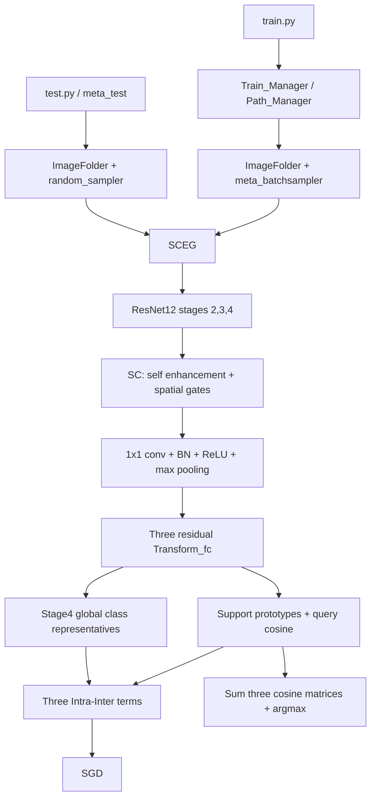

# Phase 0 — 官方仓库调查

审计日期：2026-10-09。源码基线：`f7f130aeb5b1b49246150574c53a874d4ce8de80`，main，共 19 个非 Git 文件。参考 clone 位于项目外 `/tmp/sceg-official-reference`。下列链接均固定 commit。

## 1. 实际结构

```text
SCEG/
├── README.md, LICENSE, config.yml, train.py, test.py, loss.py
├── models/SCEG.py, SC.py, backbones/ResNet.py
├── trainers/trainer.py, SCEG_train.py, eval.py
├── datasets/dataloaders.py, samplers.py, transform_manager.py
├── scripts/run.sh, test.sh
└── utils/l2_norm.py, util.py
```

没有 requirements.txt，尽管 README 声称提供。也没有类别 split 清单、数据、checkpoint 和测试。

## 2. 模块依赖与数据流



来源：[SCEG.py L44–113](https://github.com/Legenddddd/SCEG/blob/f7f130aeb5b1b49246150574c53a874d4ce8de80/models/SCEG.py#L44)、[SCEG_train.py L10–84](https://github.com/Legenddddd/SCEG/blob/f7f130aeb5b1b49246150574c53a874d4ce8de80/trainers/SCEG_train.py#L10)。

输入 `[way*(shot+query),3,84,84]`，先按类排列所有 support，再按类排列所有 query；不能按类交错 support/query。训练用每类 5 support + 15 query，10-way 共 200 张。ResNet12 返回 `[B,160,21,21]`、`[B,320,10,10]`、`[B,640,5,5]`，三个 SC 输出均为 `[B,640]`。分类输出顺序为 stage3、stage4、stage2，另返回全 batch 的 `[B,base_classes]`。

## 3. 训练 pipeline

1. `config.yml` 中 data_path 加上数据集固定目录名；ImageFolder 的分类子目录决定全局标签。
2. 每轮训练采样器先打乱每类图片，按剩余图片数量加权选择 10 类，无放回选类；消耗图片，剩余不足 20 张时移除该类。不是固定 episodes/epoch。
3. SC 同时做自增强和跨尺度单通道空间门控。CUB/Dogs 启用 stage3→stage2，Cars/Flowers 仍计算该门控，但丢弃其输出。
4. `Transform_fc(z)=0.3*z+0.7*ELU(Linear(BN(z)))`，support 先平均再归一化。
5. 总损失为三个 episode Intra-Inter loss 加一个 stage4 全局 class-representative loss，等权求和。
6. 官方 run.sh：SGD lr=0.1、momentum=0.9、Nesterov=true、weight_decay=0.0005、StepLR(step_size=400,gamma=0.1)，400×2=800 epochs，seed=42，单 GPU。每 20 epochs 验证，5-way 5-shot、1000 episodes，按验证均值保存最佳权重。
7. λ 以 run.sh 的 **38** 为基准；parser 默认 36，loss 类默认 32，不能混淆。margin=0.05、intra=0.85。
8. 原代码对 random 未设种子、对 torch/NumPy 设种子；DropBlock 的 batch counter 是普通 Python 属性，eval forward 也递增，未进入 state_dict。

来源：[run.sh](https://github.com/Legenddddd/SCEG/blob/f7f130aeb5b1b49246150574c53a874d4ce8de80/scripts/run.sh)、[trainer.py](https://github.com/Legenddddd/SCEG/blob/f7f130aeb5b1b49246150574c53a874d4ce8de80/trainers/trainer.py)、[samplers.py](https://github.com/Legenddddd/SCEG/blob/f7f130aeb5b1b49246150574c53a874d4ce8de80/datasets/samplers.py)。

## 4. 测试 pipeline

加载最佳验证模型，eval/no_grad，随机选类、随机选图，三个 cosine 相加后 argmax。query 固定为 **16**：sampler 忽略 query_shot 参数。最终每个 shot 使用 2000 episodes。官方 train 的自动测试是默认 5-way；独立 test.py 默认 50-way，其他数据集 many-way 应由其 novel 类数确定，不把 50 硬套到所有数据集。

报告百分比均值与 `1.96*sqrt(np.var(episode_acc)/n)`，方差 ddof=0。不同于 t 分布、样本方差或逐图片的置信区间。

## 5. 数据来源

官方目录：`CUB_fewshot_raw`、`StanfordDogs_fewshot`、`StanfordCars_fewshot`、`flower102_fewshot`。均需 train/val/test，run.sh 的 --pre 另需 val_pre/test_pre。

[作者 README](https://github.com/Legenddddd/SCEG/blob/f7f130aeb5b1b49246150574c53a874d4ce8de80/README.md) 引用 [FRN](https://github.com/Tsingularity/FRN)，但 FRN README 没有 Dogs/Cars/Flowers 的 split；这不能证明四者都具有 FRN 官方清单。

现有只读来源：`/root/projects/aris/fewshot/data/fsfg/`。旧CUB为100/50/50类、5885/2950/2953图，但属于0-based CloserLook风格，**不是实际FRN class身份**。正式CUB另按FRN原始IDs1..200规则准备为5903/2927/2958图（数据字节不变）。Cars130/17/49类、10744/1408/4033图，镜像像素与作者原始archive等价性未核验。复制均独立hash验证。Dogs/Flowers原图现已下载，精确class split仍未核验，不能据类别数自行生成。

## 6. 论文证据及差异

[论文正文](https://openaccess.thecvf.com/content/CVPR2026/papers/Zhao_From_Few-way_to_Many-way_Rethinking_Few-shot_Fine-grained_Image_Classification_CVPR_2026_paper.pdf)：§3.3 SC，§3.4/式18–22 Intra-Inter，§4.1.2 many-way 等于 novel 类数。已核验 Table1 的 SCEG 均值：

| 数据 | 5-way 1-shot | 5-way 5-shot | many-way 1-shot | many-way 5-shot |
|---|---:|---:|---:|---:|
| CUB |87.79|94.56|56.02|73.69|
| Dogs |77.89|89.13|47.55|66.63|
| Cars |91.18|97.35|64.87|84.08|
| Flowers102 |87.07|95.63|69.71|85.85|

这些是论文目标值，**不是本项目实验结果**。Flowers数值来自Table2。已追加核验补充材料§7.1/§7.2：CUB100/50/50，Dogs70/20/30，Cars130/17/49，Flowers51/26/25；单3090、SGD/momentum.9/lr.1/wd5e-4、Cars/Flowers禁用stage3→stage2、最佳val模型、2000测试episodes。类别数不能替代精确类别身份。PDF哈希见sources/manifest.yaml。论文温度可学习与实际不优化lambda的冲突、Cars/Flowers论文intra.65与发布配置不足见discrepancy_report.md。

## Phase 0 验证与下一步

完成：入口、19 文件清单、关键公式与真实 shape、训练/测试设置、数据来源静态审计。验证：固定 commit，三个独立只读审计结论整合。风险：未调用参数、设备硬编码、resume/multi-GPU 缺陷、未知的 Dogs/Flowers 清单、依赖缺失和版本差异。下一步：先模型 skeleton 与官方权重对齐验证，再 shape、gradient，随后真实四图 overfit；禁止先写完整 trainer。
